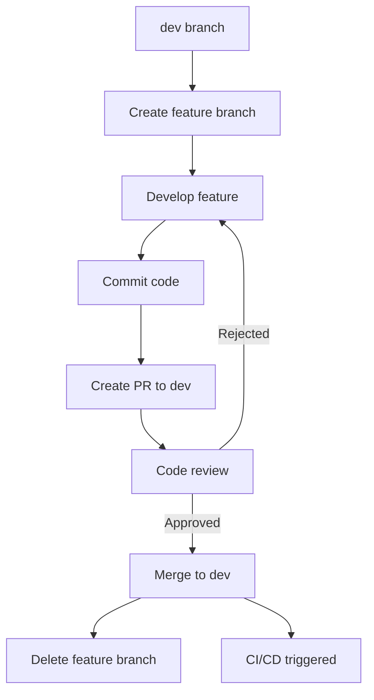
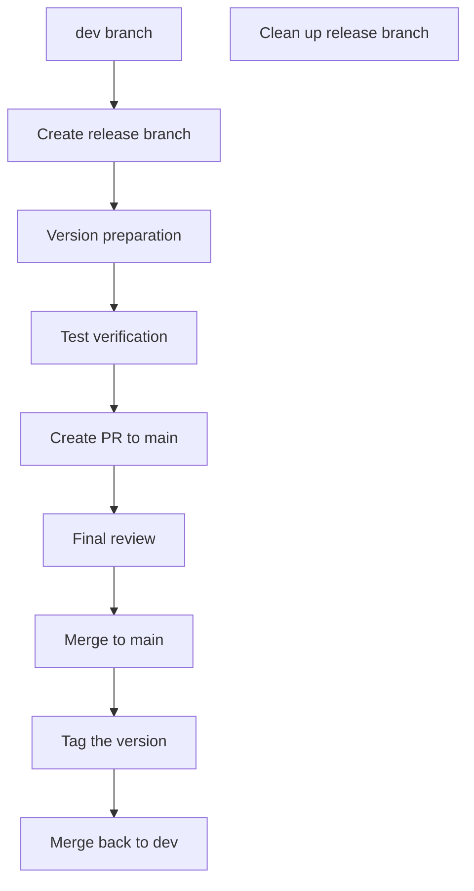

# Git Branch Maintenance Manual

> This manual defines the Git branch management strategy for the YaoXiang project, aimed at ensuring
> orderly development and efficient collaboration on the codebase.

---

## 📋 Table of Contents

- [Branch Type Specifications](#branch-type-specifications)
- [Naming Rules](#naming-rules)
- [Branch Lifecycle](#branch-lifecycle)
- [Workflow](#workflow)
- [Worktree Parallel Workbench](#worktree-parallel-workbench)
- [Branch Protection Strategy](#branch-protection-strategy)
- [Best Practices](#best-practices)
- [FAQ](#faq)

---

## 🏷️ Branch Type Specifications

### Core Branches

| Branch Name | Purpose                     | Lifecycle | Protection Level  |
| ----------- | --------------------------- | --------- | ----------------- |
| `main`      | Production environment code | Permanent | Strict protection |
| `dev`       | Main development branch     | Permanent | Medium protection |

### Feature Branches

| Prefix     | Purpose                    | Naming Examples                                       | Merge Target   |
| ---------- | -------------------------- | ----------------------------------------------------- | -------------- |
| `feature/` | New feature development    | `feature/type-inference`<br>`feature/ownership-model` | `dev`          |
| `bugfix/`  | Fix known defects          | `bugfix/memory-leak`<br>`bugfix/parser-error`         | `dev`          |
| `hotfix/`  | Urgent production fixes    | `hotfix/security-patch`<br>`hotfix/crash-bug`         | `main` + `dev` |
| `release/` | Release preparation branch | `release/v0.8.0`<br>`release/v1.0.0`                  | `main`         |

### Auxiliary Branches

| Prefix      | Purpose               | Naming Examples                                            | Merge Target |
| ----------- | --------------------- | ---------------------------------------------------------- | ------------ |
| `docs/`     | Documentation updates | `docs/api-reference`<br>`docs/tutorial-update`             | `dev`        |
| `ci/`       | CI/CD configuration   | `ci/add-deploy-script`<br>`ci/optimize-build`              | `dev`        |
| `refactor/` | Code refactoring      | `refactor/lexer-optimization`<br>`refactor/memory-manager` | `dev`        |
| `test/`     | Test-related changes  | `test/add-integration`<br>`test/performance-bench`         | `dev`        |

---

## 📝 Naming Rules

### Basic Naming Format

```bash
# Feature branch
<type>/<short-description>

# Examples
feature/add-type-inference
bugfix/fix-parser-crash
hotfix/security-vulnerability
```

### Naming Conventions

1. **Use lowercase**: All branch names use lowercase
2. **Use hyphens as separators**: Use `-` to separate words, not underscores
3. **Descriptive naming**: Branch names should clearly express their purpose
4. **Avoid special characters**: Do not use spaces, dots, or other special characters
5. **Length limit**: Branch names should not exceed 50 characters

### Detailed Examples

```bash
# ✅ Good names
feature/user-authentication-system
bugfix/fix-compilation-error-on-windows
hotfix/memory-leak-in-vm
docs/update-api-documentation
refactor/optimize-lexer-performance
test/add-e2e-test-cases

# ❌ Bad names
Feature/NewFeature  # uses uppercase
bug_fix             # uses underscores
hotfix/fix          # description is unclear
feature/ADD_NEW_FEATURE_WITH_LOTS_OF_DETAILS_THAT_IS_TOO_LONG  # too long
```

---

## 🔄 Branch Lifecycle

### Creating a Branch

```bash
# 1. Create from the latest dev branch
git checkout dev
git pull origin dev
git checkout -b feature/your-feature-name

# 2. Push the remote branch
git push -u origin feature/your-feature-name
```

### Developing on a Branch

```bash
# Periodically sync the latest code
git checkout dev
git pull origin dev
git checkout feature/your-feature-name
git rebase dev  # or git merge dev

# Commit code
git add .
git commit -m ":sparkles: feat(frontend): add type inference feature"
git push origin feature/your-feature-name
```

### Merging a Branch

```bash
# 1. Create a Pull Request
# 2. After code review is approved
git checkout dev
git pull origin dev
git merge --no-ff feature/your-feature-name
git push origin dev

# 3. Clean up the branch
git branch -d feature/your-feature-name  # delete locally
git push origin --delete feature/your-feature-name  # delete remotely
```

### Deleting a Branch

```bash
# Delete merged feature branches
git branch -d feature/completed-feature
git push origin --delete feature/completed-feature

# Batch clean up merged branches
git branch --merged dev | grep feature | xargs -n 1 git branch -d
```

---

## 🚀 Workflow

### Feature Development Workflow



### Urgent Fix Workflow


### Dependabot Security Updates (Always Target `main`, Treated as Urgent Fixes)

GitHub's Dependabot **security updates** do not read the `target-branch` in
`.github/dependabot.yml`: they are driven by the dependency graph alerts of the **default branch**
(which is `main` in this repository), so PRs always target `main`. Only the weekly **version
update** PRs go to `dev` as usual. This is GitHub's existing behavior, not a misconfiguration (see
[dependabot-core#2767](https://github.com/dependabot/dependabot-core/issues/2767), which is still
not supported).

Therefore, handle security update PRs following the flow above—neither step can be skipped:

1. **Merge them into `main`**. Do not rebase onto `dev`—alerts are evaluated based on the default
   branch, and rebasing will only keep the alert hanging; Dependabot may also open another PR for
   `main` against the same alert.
2. **The same day**, reverse-merge `main` back into `dev`:

```bash
git fetch origin
git switch dev
git merge --ff-only origin/main   # fast-forward directly when dev has no independent commits
git push origin dev
```

If `dev` has independent commits and cannot fast-forward, use `git merge origin/main` instead (the
resulting history is `Merge remote-tracking branch 'origin/main' into dev`).

> **Scope**: Build-time dependencies like `docs/` (not part of release artifacts) follow the flow
> above. **Cargo production dependencies** (runtime dependencies bundled into binaries) **do not
> apply**: waiting for weekly version updates or the next release would delay the fix by over a
> week. In that case, manually open a PR against `dev` and let the fix reach `main` with the next
> release.

### Release Workflow



---

## 🗂️ Worktree Parallel Workbench

> **Use case**: A single developer needs to handle multiple "must-open-a-branch" tasks in parallel
> while keeping the `dev` working directory stable. By convention, use a worktree as a personal
> parallel workbench—**create on demand, delete when done**; do not keep it resident: an idle
> workbench only consumes disk space (a previously resident workbench `E:/git/YaoXiang-wt` was
> deleted on 2026-10-15 because it was idle and had no unmerged commits).

### Conventions

| Item           | Value                         | Description                                                                               |
| -------------- | ----------------------------- | ----------------------------------------------------------------------------------------- |
| Workbench path | `E:/git/YaoXiang-wt`          | Fixed path, no task suffix; rename with `git worktree move`                               |
| Parking branch | `scratch`                     | "Parking spot" between tasks; local only, not pushed; deleted together with the workbench |
| Task branch    | Follow the naming rules above | Each task is created and used in the worktree, deleted when done                          |

> **Division of labor with AGENTS.md item 9**: Item 9 governs the **batch validation tree** (sole
> entry point `scripts/dev/scratch.py`, fixed to be built inside the repository's working area at
> `target/yx-scratch/<batch>/tree`, which is **excluded by `.gitignore` and never committed**; its
> contents must not be cited as documentation references—AGENTS meta-rule ①), and forbids members
> from creating directories outside the repository. This section covers the **human's personal
> parallel branch workbench**—the former serves freeze-point measurement, the latter serves branch
> development; different purposes, but the same principle: **do not keep it resident**.

### A Complete Task Loop

```bash
# 0. Create on demand (delete when done)
git worktree add E:/git/YaoXiang-wt -b scratch dev

# 1. Claim a task: cut a task branch from the latest dev inside the worktree
cd E:/git/YaoXiang-wt
git switch -c <task-branch> dev

# 2. Develop and commit (the hook chain runs as usual in the worktree)

# 3. Merge: do it in the [main repository], not in the worktree
cd E:/git/YaoXiang
git merge <task-branch>   # for small fixes, fast-forward directly to keep dev's first-parent history linear

# 4. Wrap up: park back to scratch → delete the merged task branch → remove the workbench
cd E:/git/YaoXiang-wt
git switch scratch
cd E:/git/YaoXiang
git branch -d <task-branch>
git worktree remove E:/git/YaoXiang-wt
git branch -d scratch
```

This loop targets personal quick fixes; larger changes still go through the PR flow above.

### Hard Constraints and Pitfalls

1. **The same branch cannot be checked out by two worktrees at the same time**. `dev` resides in the
   main repository, so `git switch dev` inside the worktree will be rejected; you can only cut new
   branches based on `dev`—which is exactly why a `scratch` parking spot is needed.
2. **Merging is always done in the main repository**. The main repository holds `dev` and is the
   only merge point; the worktree is only responsible for development and commits on task branches.
3. **`target/` build artifacts are not shared**. Each worktree compiles independently (this repo is
   about 160k lines of Rust; the first full rebuild takes several minutes). Conversely, the build
   cache only remains effective when "branch work is done over several consecutive days"—that is its
   main benefit; when idle the benefit is zero, and the workbench should be removed promptly.
4. **Hooks are shared and execute normally**. The worktree and the main repository share the same
   hook configuration; the full hook chain runs on commit as usual (a historical `GIT_DIR` leak
   issue in worktrees has been fixed); do not run `pre-commit install` / `autoupdate` inside the
   worktree.
5. **Always use absolute paths**—relative paths on Windows are easy to get wrong.
6. Common management commands: `git worktree list` / `git worktree move <old-path> <new-path>` /
   `git worktree remove <path>`.
7. **`git worktree remove` may leave directory residue on Windows**: for a workbench that has
   installed `node_modules` (pnpm uses junctions), after deletion the files are cleared and the
   worktree is unregistered from `.git/worktrees`, but the junction skeletons and empty directories
   remain (one real measurement: 1238 junctions, 0 files, 0 bytes). At that point the path is an
   ordinary directory—clean it up with `cmd /c rd /s /q <path>`; before deleting, confirm that all
   junctions' targets fall within that directory (iterate with `Get-ChildItem -Recurse -Force` and
   check `.Target`), otherwise recursive deletion may reach into other trees.

---

## 🛡️ Branch Protection Strategy

### Main Branch Protection

**main branch**

- No direct push allowed
- Must merge via PR
- No force push allowed
- Code review required
- Status checks must pass

**dev branch**

- No direct push (for developers)
- PR merge required
- Status checks must pass
- Admins may push directly

### Branch Permission Settings

| Branch Type | Developer   | Maintainer  | Admin       |
| ----------- | ----------- | ----------- | ----------- |
| `main`      | PR only     | PR only     | Approve PR  |
| `dev`       | PR merge    | PR merge    | Direct push |
| `feature/*` | Full access | Full access | Full access |
| `hotfix/*`  | Full access | Full access | Full access |

---

## ✅ Best Practices

### 1. Branch Management

- **Sync frequently**: Regularly pull the latest code from the `dev` branch
- **Atomic commits**: Each commit should contain only related changes
- **Clean up promptly**: Delete completed feature branches promptly after merge
- **Clear descriptions**: Branch names and commit messages should clearly express intent

### 2. Commit Conventions

Follow the [Commit Conventions](commit-convention.md):

```bash
# Format
:emoji: type(scope): subject (Chinese)

# Examples
:sparkles: feat(frontend): add type inference feature
:bug: fix(parser): fix parser crash issue
:recycle: refactor(vm): refactor VM memory management
```

### 3. Pull Request

- **Clear description**: Detail the changes and reasons
- **Link issues**: Use `Closes #123` to link related Issues
- **Respond promptly**: Reply to review comments in a timely manner
- **Adequate testing**: Ensure all tests pass

### 4. Code Review

- **Functional correctness**: Verify that the code works correctly
- **Code quality**: Check whether the code follows the conventions
- **Test coverage**: Ensure there is appropriate test coverage
- **Documentation updates**: Check whether documentation needs updating

---

## ❓ FAQ

### Q1: How do I choose a branch type?

**Answer:**

- New feature → `feature/`
- Known defect fix → `bugfix/`
- Urgent production fix → `hotfix/`
- Documentation update → `docs/`
- Code refactoring → `refactor/`
- Test-related → `test/`

### Q2: Which branch should a feature branch be created from?

**Answer:** Always create from the `dev` branch to ensure the feature is based on the latest
development code:

```bash
git checkout dev
git pull origin dev
git checkout -b feature/new-feature
```

### Q3: When should I create a release branch?

**Answer:**

- When preparing to release a new version
- When you need to freeze new feature additions
- When you need a dedicated branch to test a stable version

### Q4: How do I handle branch conflicts?

**Answer:**

1. Update the target branch: `git checkout dev && git pull origin dev`
2. Switch to the feature branch: `git checkout feature/your-branch`
3. Merge and resolve conflicts: `git rebase dev` or `git merge dev`
4. Continue development after resolving conflicts

### Q5: How is a hotfix branch handled?

**Answer:**

1. Create from the `main` branch: `git checkout main && git checkout -b hotfix/urgent-fix`
2. Fix the issue and test
3. Create PRs to both `main` and `dev` simultaneously
4. Deploy immediately after merging

### Q6: Is there a length limit for branch names?

**Answer:** It is recommended to keep it within 50 characters for clarity. Git itself supports
longer names, but overly long names hurt readability.

---

## 📚 Related Documents

- [Commit Conventions](commit-convention.md)
- [Test Specification](test-specification.md)

---

## 🔧 Tools and Scripts

### Batch Clean Up Merged Branches

```bash
# Delete local branches already merged into dev
git checkout dev
git pull origin dev
git branch --merged dev | grep -E "^(feature|bugfix|docs|refactor|test)/" | xargs -n 1 git branch -d

# Prune remote branches already merged
git remote prune origin
```

### Branch Creation Template

```bash
#!/bin/bash
# Helper script to create a feature branch

BRANCH_TYPE=$1
BRANCH_NAME=$2

if [ -z "$BRANCH_TYPE" ] || [ -z "$BRANCH_NAME" ]; then
    echo "Usage: $0 <type> <branch-name>"
    echo "Types: feature, bugfix, hotfix, docs, refactor, test"
    exit 1
fi

git checkout dev
git pull origin dev
git checkout -b "$BRANCH_TYPE/$BRANCH_NAME"
git push -u origin "$BRANCH_TYPE/$BRANCH_NAME"

echo "Created and pushed branch: $BRANCH_TYPE/$BRANCH_NAME"
```

---

> 💡 **Tip**: Keep branches atomic and focused—each branch should do one thing. This makes code
> management clearer and more efficient!

> 📞 **Support**: If you have questions, please discuss them in GitHub Discussions.
