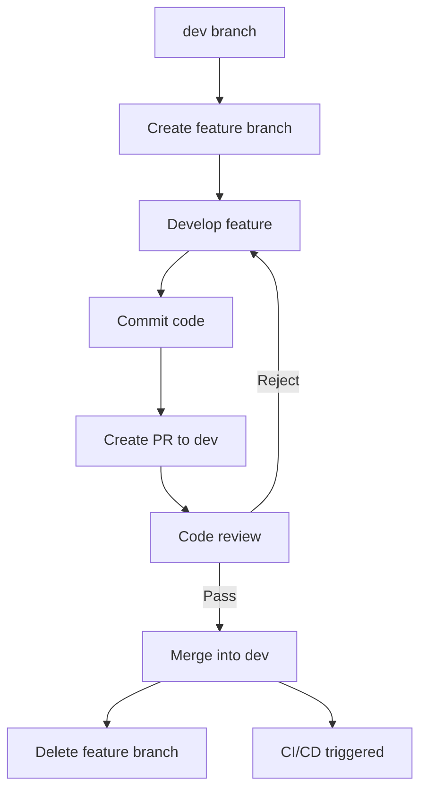
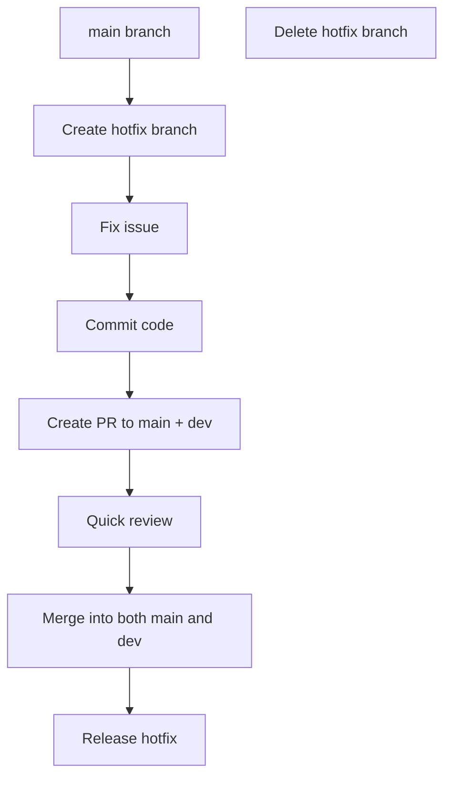
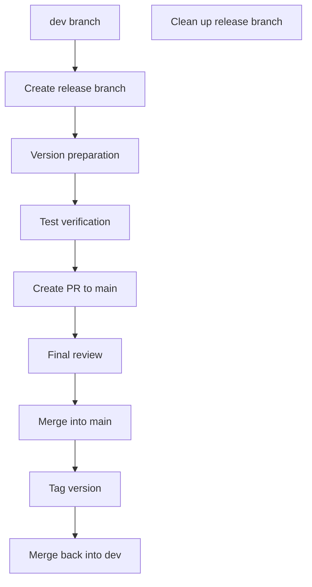

# Git Branch Maintenance Manual

> This manual defines the Git branch management strategy for the YaoXiang project, aiming to ensure
> orderly development and efficient collaboration of the codebase.

---

## 📋 Table of Contents

- [Branch Type Specifications](#branch-type-specifications)
- [Naming Rules](#naming-rules)
- [Branch Lifecycle](#branch-lifecycle)
- [Workflow](#workflow)
- [Worktree Parallel Workbench](#worktree-parallel-workbench)
- [Branch Protection Strategy](#branch-protection-strategy)
- [Best Practices](#best-practices)
- [FAQ](#faq)

---

## 🏷️ Branch Type Specifications

### Core Branches

| Branch Name | Purpose                     | Lifecycle | Protection Level   |
| ----------- | --------------------------- | --------- | ------------------ |
| `main`      | Production environment code | Permanent | Strictly protected |
| `dev`       | Main development branch     | Permanent | Medium protection  |

### Feature Branches

| Prefix     | Purpose                       | Naming Examples                                       | Merge Target   |
| ---------- | ----------------------------- | ----------------------------------------------------- | -------------- |
| `feature/` | New feature development       | `feature/type-inference`<br>`feature/ownership-model` | `dev`          |
| `bugfix/`  | Fix known defects             | `bugfix/memory-leak`<br>`bugfix/parser-error`         | `dev`          |
| `hotfix/`  | Urgent production issue fixes | `hotfix/security-patch`<br>`hotfix/crash-bug`         | `main` + `dev` |
| `release/` | Release preparation branch    | `release/v0.8.0`<br>`release/v1.0.0`                  | `main`         |

### Auxiliary Branches

| Prefix      | Purpose                     | Naming Examples                                            | Merge Target |
| ----------- | --------------------------- | ---------------------------------------------------------- | ------------ |
| `docs/`     | Documentation updates       | `docs/api-reference`<br>`docs/tutorial-update`             | `dev`        |
| `ci/`       | CI/CD configuration changes | `ci/add-deploy-script`<br>`ci/optimize-build`              | `dev`        |
| `refactor/` | Code refactoring            | `refactor/lexer-optimization`<br>`refactor/memory-manager` | `dev`        |
| `test/`     | Test-related changes        | `test/add-integration`<br>`test/performance-bench`         | `dev`        |

---

## 📝 Naming Rules

### Basic Naming Format

```bash
# Feature branch
<type>/<short-description>

# Example
feature/add-type-inference
bugfix/fix-parser-crash
hotfix/security-vulnerability
```

### Naming Conventions

1. **Use lowercase letters**: All branch names use lowercase
2. **Use hyphens to separate words**: Use `-` to separate words, not underscores
3. **Descriptive naming**: Branch names should clearly express their purpose
4. **Avoid special characters**: Do not use spaces, dots, or other special characters
5. **Length limit**: Branch name should not exceed 50 characters

### Detailed Examples

```bash
# ✅ Good naming
feature/user-authentication-system
bugfix/fix-compilation-error-on-windows
hotfix/memory-leak-in-vm
docs/update-api-documentation
refactor/optimize-lexer-performance
test/add-e2e-test-cases

# ❌ Bad naming
Feature/NewFeature  # Uses uppercase
bug_fix            # Uses underscores
hotfix/fix        # Description is unclear
feature/ADD_NEW_FEATURE_WITH_LOTS_OF_DETAILS_THAT_IS_TOO_LONG  # Too long
```

---

## 🔄 Branch Lifecycle

### Branch Creation

```bash
# 1. Create from the latest dev branch
git checkout dev
git pull origin dev
git checkout -b feature/your-feature-name

# 2. Push the remote branch
git push -u origin feature/your-feature-name
```

### Branch Development

```bash
# Periodically sync the latest code
git checkout dev
git pull origin dev
git checkout feature/your-feature-name
git rebase dev  # Or git merge dev

# Commit code
git add .
git commit -m ":sparkles: feat(frontend): 添加类型推断功能"
git push origin feature/your-feature-name
```

### Branch Merging

```bash
# 1. Create a Pull Request
# 2. After the code review passes
git checkout dev
git pull origin dev
git merge --no-ff feature/your-feature-name
git push origin dev

# 3. Clean up the branch
git branch -d feature/your-feature-name  # Local delete
git push origin --delete feature/your-feature-name  # Remote delete
```

### Branch Deletion

```bash
# Delete merged feature branches
git branch -d feature/completed-feature
git push origin --delete feature/completed-feature

# Batch clean up merged branches
git branch --merged dev | grep feature | xargs -n 1 git branch -d
```

---

## 🚀 Workflow

### Feature Development Workflow



### Hotfix Workflow



### Dependabot Security Updates (Always Target `main`, Handled as Hotfixes)

GitHub's Dependabot **security updates** do not read `target-branch` from `.github/dependabot.yml`:
they are driven by the dependency graph alerts on the **default branch** (this repo's is `main`),
and PRs always target `main`. The weekly **version update** PRs continue to go to `dev` as usual.
This is GitHub's existing behavior, not a misconfiguration
([dependabot-core#2767](https://github.com/dependabot/dependabot-core/issues/2767) has not supported
redirection so far).

Therefore, security update PRs are handled according to the workflow above—these two steps are both
required:

1. **Merge it into `main`**. Do not rebase to `dev`—alert determination is based on the default
   branch; rebasing would only keep the alert pending, and Dependabot may even open another PR for
   the same alert against `main`.
2. **The same day**, reverse-merge `main` back into `dev`:

```bash
git fetch origin
git switch dev
git merge --ff-only origin/main   # Fast-forward directly if dev has no independent commits
git push origin dev
```

If `dev` already has independent commits and cannot fast-forward, use `git merge origin/main`
instead (history shape: `Merge remote-tracking branch 'origin/main' into dev`).

> **Scope**: **Build-time** dependencies (such as `docs/`) that don't end up in release artifacts
> follow the above. **Cargo production dependencies** (runtime dependencies baked into the binary)
> **do not apply**: waiting for the weekly version update or the next release would drag the fix out
> by over a week—in that case, manually open a PR on `dev` and let it reach `main` via the next
> release.

### Release Workflow



---

## 🗂️ Worktree Parallel Workbench

> Use case: A single person needs to handle multiple "must-branch" tasks in parallel while keeping
> the `dev` working directory stable. Designate one worktree as a personal parallel
> workbench—**create on demand, delete when done**, not permanent: an empty workbench only takes up
> disk space (a local permanent workbench `E:/git/YaoXiang-wt` was once kept, but was deleted on
> 2026-10-15 because it was empty with no unmerged commits).

### Conventions

| Item           | Value                         | Description                                                                                 |
| -------------- | ----------------------------- | ------------------------------------------------------------------------------------------- |
| Workbench path | `E:/git/YaoXiang-wt`          | Fixed path, no task suffix; use `git worktree move` to rename                               |
| Parking branch | `scratch`                     | A "parking spot" between tasks, local only, not pushed; deleted together with the workbench |
| Task branches  | Follow the naming rules above | Each task creates and uses a branch in the worktree on demand, delete when done             |

> **Division of labor with item 9 of AGENTS.md**: Item 9 constrains the **batch validation tree**
> (sole entry `scripts/dev/scratch.py`, fixed to be built inside the repo at
> `target/yx-scratch/<batch>/tree`, members are prohibited from creating new directories outside the
> repo); this section describes a **human parallel personal branch workbench**—the former serves
> freeze-point measurements, the latter serves branch development; different purposes, but the same
> principle: **not permanent**.

### Full Loop for One Task

```bash
# 0. Create on demand (delete when done)
git worktree add E:/git/YaoXiang-wt -b scratch dev

# 1. Take task: in the worktree, switch to a task branch from the latest dev
cd E:/git/YaoXiang-wt
git switch -c <task-branch> dev

# 2. Develop, commit (hook chain runs normally in the worktree)

# 3. Merge: do it in the 【main repo】, not in the worktree
cd E:/git/YaoXiang
git merge <task-branch>   # Small-step fixes go directly fast-forward, keeping the dev first-parent history linear

# 4. Wrap up: park back to scratch → delete merged task branch → delete workbench
cd E:/git/YaoXiang-wt
git switch scratch
cd E:/git/YaoXiang
git branch -d <task-branch>
git worktree remove E:/git/YaoXiang-wt
git branch -d scratch
```

This loop targets personal quick fixes; larger changes still go through the PR workflow above.

### Hard Constraints and Pitfalls

1. **The same branch cannot be checked out by two worktrees simultaneously**. `dev` lives in the
   main repo, so `git switch dev` in the worktree will be rejected; you can only base new branches
   on `dev`—this is exactly why the `scratch` parking spot is needed.
2. **All merges happen in the main repo**. The main repo holds `dev` and is the only merge point;
   the worktree only handles development and commits on task branches.
3. **`target/` build artifacts are not shared**. Each worktree compiles independently (this repo is
   about 160K lines of Rust, the first full rebuild takes several minutes); conversely, build cache
   only stays effective during stretches of "branching daily for days"—that's the main benefit; when
   empty, the benefit is zero, so it should be deleted promptly.
4. **Hooks are shared and execute normally**. The worktree and the main repo share the same hook
   configuration, and the full hook chain runs normally on commit (the historical `GIT_DIR` leak
   issue in worktrees has been fixed); do not run `pre-commit install` / `autoupdate` inside the
   worktree.
5. **Always use absolute paths**; relative paths on Windows are an easy trap.
6. Common management commands: `git worktree list` / `git worktree move <old-path> <new-path>` /
   `git worktree remove <path>`.
7. **`git worktree remove` on Windows may leave directory residue**: a workbench where
   `node_modules` was installed (pnpm uses junctions)—after deletion, the files are cleared and the
   worktree is deregistered from `.git/worktrees`, but the junction skeleton and empty directories
   remain (a real test: 1238 residual junctions, 0 files, 0 bytes). At that point the path is just
   an ordinary directory; use `cmd /c rd /s /q <path>` to clean it up; before deletion, confirm that
   all junction targets fall within that directory (`Get-ChildItem -Recurse -Force` to fetch each
   `.Target`), otherwise the recursive deletion may tunnel through into another tree.

---

## 🛡️ Branch Protection Strategy

### Main Branch Protection

**main branch**

- Direct push prohibited
- Must merge via PR
- Force push prohibited
- Code review required
- Status checks must pass

**dev branch**

- Direct push prohibited (for developers)
- PR merge required
- Status checks must pass
- Admin direct push allowed

### Branch Permission Settings

| Branch Type | Developer       | Maintainer      | Admin           |
| ----------- | --------------- | --------------- | --------------- |
| `main`      | PR only         | PR only         | Approve PR      |
| `dev`       | PR merge        | PR merge        | Direct push     |
| `feature/*` | Full permission | Full permission | Full permission |
| `hotfix/*`  | Full permission | Full permission | Full permission |

---

## ✅ Best Practices

### 1. Branch Management

- **Frequent sync**: Regularly pull the latest code from the `dev` branch
- **Atomic commits**: Each commit contains only related changes
- **Timely cleanup**: Delete completed feature branches promptly after merging
- **Clear descriptions**: Branch names and commit messages should clearly express intent

### 2. Commit Conventions

Follow the [Commit Conventions](commit-convention.md):

```bash
# Format
:emoji: type(scope): subject (in Chinese)

# Example
:sparkles: feat(frontend): 添加类型推断功能
:bug: fix(parser): 修复解析器崩溃问题
:recycle: refactor(vm): 重构虚拟机内存管理
```

### 3. Pull Request

- **Clear description**: Detail the changes and reasons
- **Link issues**: Use `Closes #123` to link related issues
- **Timely response**: Respond to review comments promptly
- **Adequate testing**: Ensure all tests pass

### 4. Code Review

- **Functional correctness**: Verify the code functions correctly
- **Code quality**: Check whether the code conforms to conventions
- **Test coverage**: Ensure there is appropriate test coverage
- **Documentation update**: Check whether documentation needs to be updated

---

## ❓ FAQ

### Q1: How to choose a branch type?

**Answer:**

- New feature → `feature/`
- Known bug fix → `bugfix/`
- Urgent production fix → `hotfix/`
- Documentation update → `docs/`
- Code refactoring → `refactor/`
- Test-related → `test/`

### Q2: Which branch should a feature branch be created from?

**Answer:** Always create from the `dev` branch to ensure the feature is based on the latest
development code:

```bash
git checkout dev
git pull origin dev
git checkout -b feature/new-feature
```

### Q3: When to create a release branch?

**Answer:**

- When preparing to release a new version
- When needing to freeze the addition of new features
- When a stable version needs dedicated testing

### Q4: How to handle branch conflicts?

**Answer:**

1. Update the target branch: `git checkout dev && git pull origin dev`
2. Switch to the feature branch: `git checkout feature/your-branch`
3. Merge and resolve conflicts: `git rebase dev` or `git merge dev`
4. Continue development after resolving conflicts

### Q5: How to handle hotfix branches?

**Answer:**

1. Create from the `main` branch: `git checkout main && git checkout -b hotfix/urgent-fix`
2. Fix the issue and test
3. Simultaneously create PRs to `main` and `dev`
4. Deploy immediately after merging

### Q6: Is there a limit on branch name length?

**Answer:** Recommended to be no more than 50 characters, kept concise and clear. Git itself
supports longer names, but overly long names affect readability.

---

## 📚 Related Documents

- [Commit Conventions](commit-convention.md)
- [Test Specifications](test-specification.md)

---

## 🔧 Tools and Scripts

### Batch Clean Up Merged Branches

```bash
# Delete local branches already merged into dev
git checkout dev
git pull origin dev
git branch --merged dev | grep -E "^(feature|bugfix|docs|refactor|test)/" | xargs -n 1 git branch -d

# Prune remote merged branches
git remote prune origin
```

### Branch Creation Template

```bash
#!/bin/bash
# Helper script to create a feature branch

BRANCH_TYPE=$1
BRANCH_NAME=$2

if [ -z "$BRANCH_TYPE" ] || [ -z "$BRANCH_NAME" ]; then
    echo "Usage: $0 <type> <name>"
    echo "Types: feature, bugfix, hotfix, docs, refactor, test"
    exit 1
fi

git checkout dev
git pull origin dev
git checkout -b "$BRANCH_TYPE/$BRANCH_NAME"
git push -u origin "$BRANCH_TYPE/$BRANCH_NAME"

echo "Branch created and pushed: $BRANCH_TYPE/$BRANCH_NAME"
```

---

> 💡 **Tip**: Maintain atomicity and focus in branches—each branch does one thing. This keeps code
> management clearer and more efficient!

> 📞 **Support**: If you have questions, please discuss them in GitHub Discussions.
