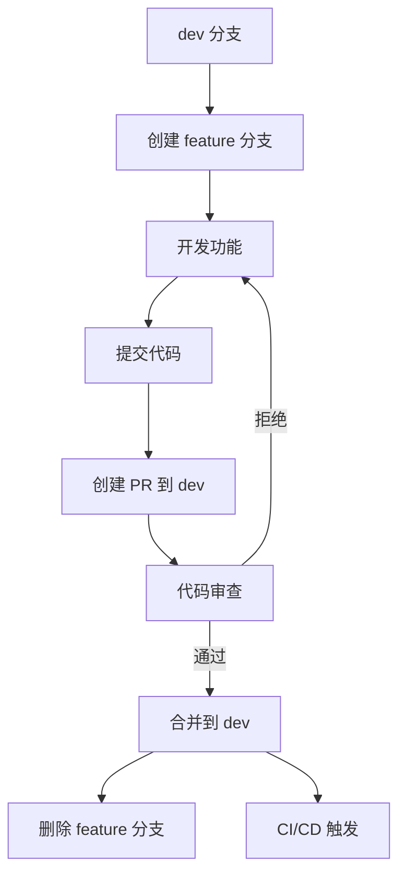
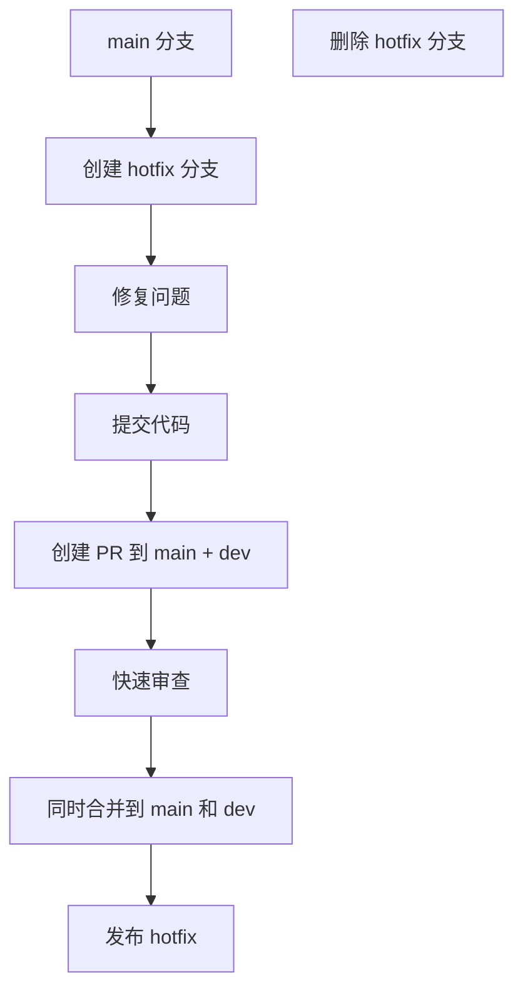
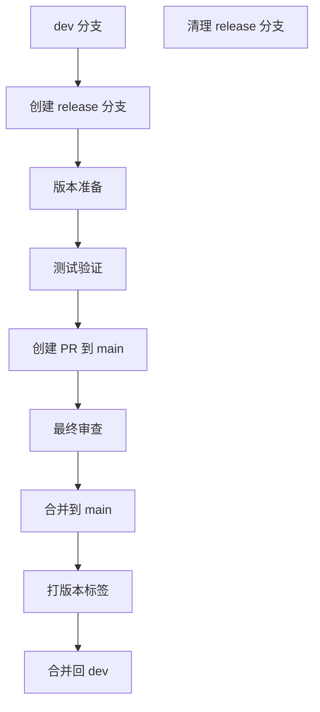

# Git Branch Maintenance Guide

> This guide defines the Git branch management strategy for the YaoXiang project, with the goal of
> ensuring orderly codebase development and efficient collaboration.

---

## 📋 Table of Contents

- [Branch Type Conventions](#分支类型规范)
- [Naming Rules](#命名规则)
- [Branch Lifecycle](#分支生命周期)
- [Workflow](#工作流程)
- [Worktree Parallel Workbench](#worktree-并行工作台)
- [Branch Protection Strategy](#分支保护策略)
- [Best Practices](#最佳实践)
- [FAQ](#常见问题)

---

## 🏷️ Branch Type Conventions

### Core Branches

| Branch Name | Purpose                    | Lifecycle | Protection Level    |
| ----------- | -------------------------- | --------- | ------------------- |
| `main`      | Production code            | Permanent | Strict protection   |
| `dev`       | Primary development branch | Permanent | Moderate protection |

### Feature Branches

| Prefix     | Purpose                          | Naming Example                                        | Merge Target   |
| ---------- | -------------------------------- | ----------------------------------------------------- | -------------- |
| `feature/` | New feature development          | `feature/type-inference`<br>`feature/ownership-model` | `dev`          |
| `bugfix/`  | Fixing known defects             | `bugfix/memory-leak`<br>`bugfix/parser-error`         | `dev`          |
| `hotfix/`  | Emergency production issue fixes | `hotfix/security-patch`<br>`hotfix/crash-bug`         | `main` + `dev` |
| `release/` | Release preparation branches     | `release/v0.8.0`<br>`release/v1.0.0`                  | `main`         |

### Auxiliary Branches

| Prefix      | Purpose                     | Naming Example                                             | Merge Target |
| ----------- | --------------------------- | ---------------------------------------------------------- | ------------ |
| `docs/`     | Documentation updates       | `docs/api-reference`<br>`docs/tutorial-update`             | `dev`        |
| `ci/`       | CI/CD configuration changes | `ci/add-deploy-script`<br>`ci/optimize-build`              | `dev`        |
| `refactor/` | Code refactoring            | `refactor/lexer-optimization`<br>`refactor/memory-manager` | `dev`        |
| `test/`     | Test-related changes        | `test/add-integration`<br>`test/performance-bench`         | `dev`        |

---

## 📝 Naming Rules

### Basic Naming Format

```bash
# Feature branch
<type>/<short-description>

# Examples
feature/add-type-inference
bugfix/fix-parser-crash
hotfix/security-vulnerability
```

### Naming Conventions

1. **Use lowercase letters**: Use lowercase letters in all branch names
2. **Separate words with hyphens**: Use `-` to separate words, not underscores
3. **Use descriptive names**: Branch names should clearly convey their purpose
4. **Avoid special characters**: Do not use spaces, periods, or other special characters
5. **Length limit**: Branch names must not exceed 50 characters

### Detailed Examples

```bash
# ✅ Good names
feature/user-authentication-system
bugfix/fix-compilation-error-on-windows
hotfix/memory-leak-in-vm
docs/update-api-documentation
refactor/optimize-lexer-performance
test/add-e2e-test-cases

# ❌ Bad names
Feature/NewFeature  # Uses uppercase letters
bug_fix            # Uses underscores
hotfix/fix        # Unclear description
feature/ADD_NEW_FEATURE_WITH_LOTS_OF_DETAILS_THAT_IS_TOO_LONG  # Too long
```

---

## 🔄 Branch Lifecycle

### Branch Creation

```bash
# 1. Create from the latest dev branch
git checkout dev
git pull origin dev
git checkout -b feature/your-feature-name

# 2. Push the remote branch
git push -u origin feature/your-feature-name
```

### Branch Development

```bash
# Synchronize with the latest code regularly
git checkout dev
git pull origin dev
git checkout feature/your-feature-name
git rebase dev  # or git merge dev

# Commit the code
git add .
git commit -m ":sparkles: feat(frontend): 添加类型推断功能"
git push origin feature/your-feature-name
```

### Branch Merging

```bash
# 1. Create a Pull Request
# 2. After the code review is approved
git checkout dev
git pull origin dev
git merge --no-ff feature/your-feature-name
git push origin dev

# 3. Clean up the branch
git branch -d feature/your-feature-name  # Delete locally
git push origin --delete feature/your-feature-name  # Delete remotely
```

### Branch Deletion

```bash
# Delete a merged feature branch
git branch -d feature/completed-feature
git push origin --delete feature/completed-feature

# Clean up merged branches in bulk
git branch --merged dev | grep feature | xargs -n 1 git branch -d
```

---

## 🚀 Workflow

### Feature Development Workflow



### Emergency Fix Workflow



### Dependabot Security Updates (Always Target `main` and Are Handled as Hotfixes)

GitHub's Dependabot **security updates** do not read the `target-branch` setting in
`.github/dependabot.yml`: they are driven by dependency graph alerts on the **default branch**
(`main` in this repository), and all PRs target `main`. Only the weekly **version update** PRs
continue to target `dev` as usual. This is existing GitHub behavior, not a configuration error
([dependabot-core#2767](https://github.com/dependabot/dependabot-core/issues/2767) still does not
support retargeting).

Therefore, security update PRs follow the workflow above, and both steps are essential:

1. **Merge it into `main`**. Do not change the base branch to `dev`: alert classification is based
   on the default branch, and changing the base branch only leaves the alert open. Dependabot may
   also open another PR against `main` for the same alert.
2. **On the same day**, merge `main` back into `dev`:

```bash
git fetch origin
git switch dev
git merge --ff-only origin/main   # Fast-forward directly when dev has no independent commits
git push origin dev
```

If `dev` has independent commits and cannot be fast-forwarded, use `git merge origin/main` instead
(the resulting history entry is `Merge remote-tracking branch 'origin/main' into dev`).

> **Scope**: Build-time dependencies such as `docs/` follow the process above. **Cargo production
> dependencies** (runtime dependencies included in the binary) **do not follow this process**:
> waiting for the weekly version update or the next release would delay the fix by more than a week.
> In that case, manually open a PR against `dev` and let the fix reach `main` with the next release.

### Release Workflow



---

## 🗂️ Worktree Parallel Workbench

> Use case: an individual needs to work in parallel on multiple tasks that "must use a branch" while
> keeping the `dev` working directory stable. By convention, one worktree serves as a personal
> parallel workbench—**created as needed and deleted when finished**, rather than kept permanently.
> An idle workbench only consumes disk space (this machine once had a permanently resident workbench
> at `E:/git/YaoXiang-wt`, which was deleted on 2026-10-15 because it was idle and had no unmerged
> commits).

### Conventions

| Item           | Value                         | Description                                                                                           |
| -------------- | ----------------------------- | ----------------------------------------------------------------------------------------------------- |
| Workbench Path | `E:/git/YaoXiang-wt`          | Fixed path with no task suffix; use `git worktree move` to rename it                                  |
| Parking Branch | `scratch`                     | A "parking spot" between tasks; exists only locally, is not pushed, and is deleted with the workbench |
| Task Branch    | Follow the naming rules above | Each task is switched to and used directly in the worktree, then deleted when complete                |

> **Division of responsibilities with the AGENTS.md team orchestration convention for "validation
> evidence"**: that convention governs the **batch validation tree** (single entry point
> `scripts/dev/scratch.py`, always created within the repository **working area**, at
> `target/yx-scratch/<batch>/tree`, which is excluded by `.gitignore` (**not committed**; its
> contents must not be cited as documentation sources—AGENTS meta-rule ①), and team members are
> prohibited from creating directories outside the repository). This section instead describes a
> **personal parallel branch workbench for humans**—the former supports frozen-point measurements,
> while the latter supports branch development. They serve different purposes but follow the same
> principle: **do not keep them permanently**.

### Complete Workflow for One Task

```bash
# 0. Create as needed (delete when finished)
git worktree add E:/git/YaoXiang-wt -b scratch dev

# 1. Claim a task: create the task branch from the latest dev in the worktree
cd E:/git/YaoXiang-wt
git switch -c <task-branch> dev

# 2. Develop and commit (the hook chain still runs in the worktree)

# 3. Merge: do this in the [main repository], not in the worktree
cd E:/git/YaoXiang
git merge <task-branch>   # Fast-forward small fixes directly to keep dev's first-parent history linear

# 4. Wrap up: switch back to scratch → delete the merged task branch → delete the workbench
cd E:/git/YaoXiang-wt
git switch scratch
cd E:/git/YaoXiang
git branch -d <task-branch>
git worktree remove E:/git/YaoXiang-wt
git branch -d scratch
```

This workflow is intended for quick personal fixes; larger changes should still follow the PR
process above.

### Hard Constraints and Pitfalls

1. **The same branch cannot be checked out in two worktrees simultaneously**. Since `dev` remains
   checked out in the main repository, `git switch dev` is rejected in the worktree. A new branch
   can only be created from `dev`, which is why the `scratch` parking branch is needed.
2. **Always merge in the main repository**. The main repository holds `dev` and is the only merge
   point; the worktree is responsible only for development and commits on the task branch.
3. **`target/` build artifacts are not shared**. Each worktree compiles independently (this
   repository contains approximately 160,000 lines of Rust, and the first full rebuild takes several
   minutes). Conversely, the build cache remains useful only during periods when branches are worked
   on for several consecutive days. This is its main benefit; there is no benefit while it is idle,
   so it should be deleted promptly.
4. **Hooks are shared and execute normally**. A worktree and the main repository share the same hook
   configuration, and the complete hook chain runs during commits as usual (the historical `GIT_DIR`
   leakage issue in worktrees has been fixed). Do not run `pre-commit install` / `autoupdate` inside
   a worktree.
5. **Always use absolute paths**. Relative paths are error-prone on Windows.
6. Common management commands: `git worktree list` / `git worktree move <old-path> <new-path>` /
   `git worktree remove <path>`.
7. **`git worktree remove` may leave directory remnants on Windows**: after deleting a workbench
   that contained `node_modules` (pnpm uses junctions), the files have been removed and the worktree
   has been unregistered from `.git/worktrees`, but the junction skeleton and empty directories
   remain (one measured instance left 1,238 junctions, 0 files, and 0 bytes). The path is then an
   ordinary directory and can be removed with `cmd /c rd /s /q <path>`. Before deleting it, verify
   that the targets of all junctions are within that directory (check `.Target` for each entry
   returned by `Get-ChildItem -Recurse -Force`); otherwise, recursive deletion may penetrate into
   another tree.

---

## 🛡️ Branch Protection Strategy

### Primary Branch Protection

**`main` branch**

- Direct pushes are prohibited
- Merges must go through a PR
- Force pushes are prohibited
- Code review is required
- Status checks must pass

**`dev` branch**

- Direct pushes are prohibited for development team members
- Merges must go through a PR
- Status checks must pass
- Administrators may push directly

### Branch Permission Settings

| Branch Type | Developers   | Maintainers  | Administrators |
| ----------- | ------------ | ------------ | -------------- |
| `main`      | PR only      | PR only      | Approve PRs    |
| `dev`       | Merge via PR | Merge via PR | Direct push    |
| `feature/*` | Full access  | Full access  | Full access    |
| `hotfix/*`  | Full access  | Full access  | Full access    |

---

## ✅ Best Practices

### 1. Branch Management

- **Frequent synchronization**: Regularly obtain the latest code from the `dev` branch
- **Atomic commits**: Each commit should contain only related changes
- **Timely cleanup**: Delete completed feature branches promptly after merging
- **Clear descriptions**: Branch names and commit messages should clearly convey their intent

### 2. Commit Conventions

Follow the [Commit Convention](commit-convention.md):

```bash
# Format
:emoji: type(scope): 主题（中文）

# Examples
:sparkles: feat(frontend): 添加类型推断功能
:bug: fix(parser): 修复解析器崩溃问题
:recycle: refactor(vm): 重构虚拟机内存管理
```

### 3. Pull Requests

- **Clear description**: Explain the changes and their rationale in detail
- **Link issues**: Use `Closes #123` to link the relevant issue
- **Prompt responses**: Respond to review comments promptly
- **Thorough testing**: Ensure that all tests pass

### 4. Code Review

- **Functional correctness**: Verify that the code functions correctly
- **Code quality**: Check that the code follows the conventions
- **Test coverage**: Ensure that appropriate tests are included
- **Documentation updates**: Check whether the documentation needs to be updated

---

## ❓ FAQ

### Q1: How do I choose a branch type?

**Answer:**

- New feature → `feature/`
- Known defect fix → `bugfix/`
- Emergency production fix → `hotfix/`
- Documentation update → `docs/`
- Code refactoring → `refactor/`
- Test-related work → `test/`

### Q2: From which branch should a feature branch be created?

**Answer:** Always create it from the `dev` branch to ensure that the feature is based on the latest
development code:

```bash
git checkout dev
git pull origin dev
git checkout -b feature/new-feature
```

### Q3: When should a release branch be created?

**Answer:**

- When preparing to release a new version
- When new feature additions need to be frozen
- When a dedicated stability test is required

### Q4: How should branch conflicts be handled?

**Answer:**

1. Update the target branch: `git checkout dev && git pull origin dev`
2. Switch to the feature branch: `git checkout feature/your-branch`
3. Merge and resolve conflicts: `git rebase dev` or `git merge dev`
4. Continue development after resolving the conflicts

**Do not resolve conflicts by taking one side of an entire file**: you must not use
`git checkout --ours` / `--theirs` (or an equivalent method) to take one side of the entire file,
because this silently discards all changes from the other side. The correct approach is a three-way
merge with `git merge-file` or to resolve each hunk individually. After resolving the conflicts, you
must compile locally and run the affected tests before committing. Commits that claim to be "pure
moves" are subject to the same constraint—the criterion for a correct move is "zero semantic diff
except for paths".

### Q5: How should a hotfix branch be handled?

**Answer:**

1. Create it from the `main` branch: `git checkout main && git checkout -b hotfix/urgent-fix`
2. Fix the issue and test it
3. Create PRs to both `main` and `dev`
4. Deploy immediately after merging

### Q6: Is there a limit on branch name length?

**Answer:** It is recommended that branch names not exceed 50 characters to keep them concise and
clear. Git itself supports longer names, but overly long names reduce readability.

---

## 📚 Related Documentation

- [Commit Convention](commit-convention.md)
- [Test Specification](test-specification.md)

---

## 🔧 Tools and Scripts

### Cleaning Up Merged Branches in Bulk

```bash
# Delete local branches already merged into dev
git checkout dev
git pull origin dev
git branch --merged dev | grep -E "^(feature|bugfix|docs|refactor|test)/" | xargs -n 1 git branch -d

# Delete remote branches that have already been merged
git remote prune origin
```

### Branch Creation Template

```bash
#!/bin/bash
# Helper script for creating a feature branch

BRANCH_TYPE=$1
BRANCH_NAME=$2

if [ -z "$BRANCH_TYPE" ] || [ -z "$BRANCH_NAME" ]; then
    echo "用法: $0 <类型> <分支名>"
    echo "类型: feature, bugfix, hotfix, docs, refactor, test"
    exit 1
fi

git checkout dev
git pull origin dev
git checkout -b "$BRANCH_TYPE/$BRANCH_NAME"
git push -u origin "$BRANCH_TYPE/$BRANCH_NAME"

echo "已创建并推送分支: $BRANCH_TYPE/$BRANCH_NAME"
```

---

> 💡 **Tip**: Keep branches atomic and focused, and make each branch do only one thing. This makes
> code management clearer and more efficient!

> 📞 **Support**: If you have any questions, please discuss them in GitHub Discussions.
