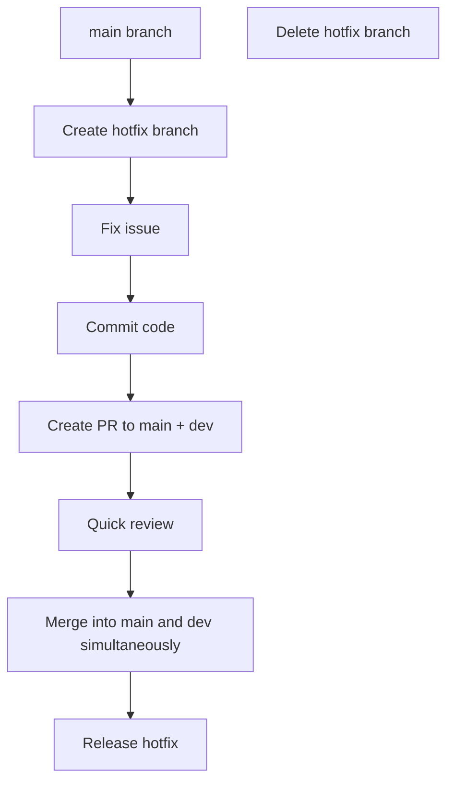
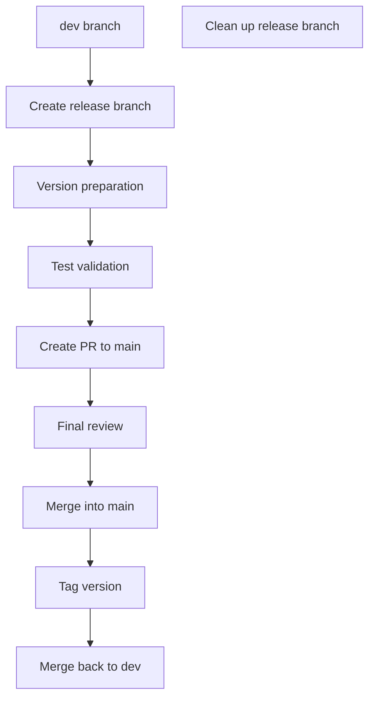

# Git Branch Maintenance Guide

> This guide defines the Git branch management strategy for the YaoXiang project, aiming to ensure
> orderly development and efficient collaboration within the codebase.

---

## 📋 Table of Contents

- [Branch Type Specifications](#branch-type-specifications)
- [Naming Rules](#naming-rules)
- [Branch Lifecycle](#branch-lifecycle)
- [Workflow](#workflow)
- [Worktree Parallel Workspace](#worktree-parallel-workspace)
- [Branch Protection Strategy](#branch-protection-strategy)
- [Best Practices](#best-practices)
- [Frequently Asked Questions](#frequently-asked-questions)

---

## 🏷️ Branch Type Specifications

### Core Branches

| Branch Name | Purpose                     | Lifecycle | Protection Level     |
| ----------- | --------------------------- | --------- | -------------------- |
| `main`      | Production environment code | Permanent | Strictly protected   |
| `dev`       | Main development branch     | Permanent | Moderately protected |

### Feature Branches

| Prefix     | Purpose                 | Naming Examples                                       | Merge Target   |
| ---------- | ----------------------- | ----------------------------------------------------- | -------------- |
| `feature/` | New feature development | `feature/type-inference`<br>`feature/ownership-model` | `dev`          |
| `bugfix/`  | Fix known defects       | `bugfix/memory-leak`<br>`bugfix/parser-error`         | `dev`          |
| `hotfix/`  | Urgent production fixes | `hotfix/security-patch`<br>`hotfix/crash-bug`         | `main` + `dev` |
| `release/` | Release preparation     | `release/v0.8.0`<br>`release/v1.0.0`                  | `main`         |

### Auxiliary Branches

| Prefix      | Purpose               | Naming Examples                                            | Merge Target |
| ----------- | --------------------- | ---------------------------------------------------------- | ------------ |
| `docs/`     | Documentation updates | `docs/api-reference`<br>`docs/tutorial-update`             | `dev`        |
| `ci/`       | CI/CD config changes  | `ci/add-deploy-script`<br>`ci/optimize-build`              | `dev`        |
| `refactor/` | Code refactoring      | `refactor/lexer-optimization`<br>`refactor/memory-manager` | `dev`        |
| `test/`     | Test-related changes  | `test/add-integration`<br>`test/performance-bench`         | `dev`        |

---

## 📝 Naming Rules

### Basic Naming Format

```bash
# Feature branches
<type>/<short-description>

# Examples
feature/add-type-inference
bugfix/fix-parser-crash
hotfix/security-vulnerability
```

### Naming Conventions

1. **Use lowercase letters**: All branch names should be lowercase
2. **Use hyphens as separators**: Use `-` to separate words, not underscores
3. **Descriptive naming**: Branch names should clearly express their purpose
4. **Avoid special characters**: No spaces, dots, or other special characters
5. **Length limit**: Branch names should not exceed 50 characters

### Detailed Examples

```bash
# ✅ Good names
feature/user-authentication-system
bugfix/fix-compilation-error-on-windows
hotfix/memory-leak-in-vm
docs/update-api-documentation
refactor/optimize-lexer-performance
test/add-e2e-test-cases

# ❌ Bad names
Feature/NewFeature  # uses uppercase
bug_fix            # uses underscores
hotfix/fix        # description is unclear
feature/ADD_NEW_FEATURE_WITH_LOTS_OF_DETAILS_THAT_IS_TOO_LONG  # too long
```

---

## 🔄 Branch Lifecycle

### Creating a Branch

```bash
# 1. Create from the latest dev branch
git checkout dev
git pull origin dev
git checkout -b feature/your-feature-name

# 2. Push the remote branch
git push -u origin feature/your-feature-name
```

### Developing on a Branch

```bash
# Periodically sync with the latest code
git checkout dev
git pull origin dev
git checkout feature/your-feature-name
git rebase dev  # or git merge dev

# Commit code
git add .
git commit -m ":sparkles: feat(frontend): 添加类型推断功能"
git push origin feature/your-feature-name
```

### Merging a Branch

```bash
# 1. Create a Pull Request
# 2. After code review passes
git checkout dev
git pull origin dev
git merge --no-ff feature/your-feature-name
git push origin dev

# 3. Clean up the branch
git branch -d feature/your-feature-name  # delete locally
git push origin --delete feature/your-feature-name  # delete remotely
```

### Deleting a Branch

```bash
# Delete a merged feature branch
git branch -d feature/completed-feature
git push origin --delete feature/completed-feature

# Batch clean up merged branches
git branch --merged dev | grep feature | xargs -n 1 git branch -d
```

---

## 🚀 Workflow

### Feature Development Flow


### Emergency Fix Flow



### Dependabot Security Updates (always target `main`, handle as emergency fix)

GitHub's Dependabot **security updates** do not read `target-branch` from `.github/dependabot.yml`:
they are driven by dependency graph alerts on the **default branch** (in this repository, `main`),
and PRs always target `main`. The weekly **version update** PRs go to `dev` as usual. This is
GitHub's existing behavior, not a misconfiguration (see
[dependabot-core#2767](https://github.com/dependabot/dependabot-core/issues/2767), which has not yet
supported redirecting).

Therefore, security update PRs should be handled according to the flow above, and both steps are
required:

1. **Merge it into `main`**. Do not rebase it onto `dev`—alert judgment is based on the default
   branch, and rebasing will only cause the alert to remain open. Dependabot may also open another
   PR against `main` for the same alert.
2. **The same day**, reverse-merge `main` back into `dev`:

```bash
git fetch origin
git switch dev
git merge --ff-only origin/main   # fast-forward if dev has no independent commits
git push origin dev
```

If `dev` already has independent commits and cannot fast-forward, use `git merge origin/main`
instead (the history shape will be `Merge remote-tracking branch 'origin/main' into dev`).

> **Scope of application**: `docs/` and similar **build-time** dependencies (not in release
> artifacts) should follow the flow above. **Cargo production dependencies** (runtime dependencies
> that go into the binary) **do not apply**: waiting for the weekly version update or the next
> release can delay the fix by more than a week, in which case a manual PR should be created on
> `dev` to fix it, and it will be merged into `main` along with the next release.

### Release Flow



---

## 🗂️ Worktree Parallel Workspace

> **Use case**: When a single developer needs to work in parallel on multiple tasks that "must be on
> a branch," while keeping the `dev` working directory stable. We agree on a **long-lived worktree**
> as a personal parallel workspace—the worktree is kept permanently, task branches are checked out
> on demand and deleted when done.

### Conventions

| Item              | Value                      | Description                                                    |
| ----------------- | -------------------------- | -------------------------------------------------------------- |
| Workspace path    | `E:/git/YaoXiang-wt`       | Fixed path, no task suffix; use `git worktree move` to rename  |
| Long-lived branch | `scratch`                  | "Parking spot" between tasks; local only, not pushed           |
| Task branch       | Follows naming rules above | Each task is checked out in the worktree and deleted when done |

### A Complete Task Loop

```bash
# 0. First-time creation (one-time only)
git worktree add E:/git/YaoXiang-wt -b scratch dev

# 1. Pick up task: in the worktree, create a task branch from the latest dev
cd E:/git/YaoXiang-wt
git switch -c <task-branch> dev

# 2. Develop and commit (the hook chain runs normally in the worktree)

# 3. Merge: do it in the [main repo], not in the worktree
cd E:/git/YaoXiang
git merge <task-branch>   # small-step fixes fast-forward directly, keeping dev first-parent history linear

# 4. Wrap up: park the worktree back at scratch, then delete the merged task branch
cd E:/git/YaoXiang-wt
git switch scratch
cd E:/git/YaoXiang
git branch -d <task-branch>
```

This loop is intended for individual quick fixes; larger changes should still go through the PR
workflow described above.

### Hard Constraints and Pitfalls

1. **The same branch cannot be checked out in two worktrees simultaneously.** Since `dev` is
   permanently in the main repo, `git switch dev` in the worktree will be rejected; you can only
   create new branches based on `dev`—which is exactly why the `scratch` parking spot is needed.
2. **Merging is always done in the main repo.** The main repo holds `dev` and is the only merge
   point; the worktree is only responsible for development and commits on the task branch.
3. **`target/` build artifacts are not shared.** Each worktree compiles independently (this
   repository has about 160k lines of Rust, with the first full rebuild taking several minutes);
   conversely, the long-lived worktree's build cache remains continuously effective, which is the
   main reason for keeping it.
4. **Hooks are shared and execute normally.** The worktree and the main repo share the same hook
   configuration, and the full hook chain runs at commit time (historical `GIT_DIR` leak issues in
   worktrees have been fixed); do not run `pre-commit install` / `autoupdate` in the worktree.
5. **Always use absolute paths**; relative paths on Windows are easy to get wrong.
6. Common management commands: `git worktree list` / `git worktree move <old-path> <new-path>` /
   `git worktree remove <path>`.

---

## 🛡️ Branch Protection Strategy

### Main Branch Protection

**main branch**

- No direct pushes
- Must be merged via PR
- No force pushes
- Code review required
- Status checks must pass

**dev branch**

- No direct pushes (for developers)
- PR merge required
- Status checks must pass
- Admins allowed to push directly

### Branch Permissions

| Branch Type | Developer   | Maintainer  | Admin       |
| ----------- | ----------- | ----------- | ----------- |
| `main`      | PR only     | PR only     | Approve PRs |
| `dev`       | PR merge    | PR merge    | Direct push |
| `feature/*` | Full access | Full access | Full access |
| `hotfix/*`  | Full access | Full access | Full access |

---

## ✅ Best Practices

### 1. Branch Management

- **Sync frequently**: Regularly pull the latest code from the `dev` branch
- **Atomic commits**: Each commit should contain only related changes
- **Clean up promptly**: Delete completed feature branches promptly after merging
- **Clear descriptions**: Branch names and commit messages should clearly express intent

### 2. Commit Conventions

Follow the [Commit Conventions](commit-convention.md):

```bash
# Format
:emoji: type(scope): 主题（中文）

# Examples
:sparkles: feat(frontend): 添加类型推断功能
:bug: fix(parser): 修复解析器崩溃问题
:recycle: refactor(vm): 重构虚拟机内存管理
```

### 3. Pull Request

- **Clear description**: Explain the content and reason for the change in detail
- **Link issues**: Use `Closes #123` to link related Issues
- **Prompt response**: Reply to review comments promptly
- **Thorough testing**: Ensure all tests pass

### 4. Code Review

- **Functional correctness**: Verify that the code functions correctly
- **Code quality**: Check that the code conforms to standards
- **Test coverage**: Ensure appropriate tests are in place
- **Documentation updates**: Check whether documentation needs to be updated

---

## ❓ Frequently Asked Questions

### Q1: How do I choose a branch type?

**Answer:**

- New feature → `feature/`
- Known defect fix → `bugfix/`
- Urgent production fix → `hotfix/`
- Documentation update → `docs/`
- Code refactoring → `refactor/`
- Test-related → `test/`

### Q2: Which branch should a feature branch be created from?

**Answer:** Always create from the `dev` branch, ensuring the feature is based on the latest
development code:

```bash
git checkout dev
git pull origin dev
git checkout -b feature/new-feature
```

### Q3: When should a release branch be created?

**Answer:**

- When preparing to release a new version
- When new feature additions need to be frozen
- When a stable version needs dedicated testing

### Q4: How to handle branch conflicts?

**Answer:**

1. Update the target branch: `git checkout dev && git pull origin dev`
2. Switch to the feature branch: `git checkout feature/your-branch`
3. Merge and resolve conflicts: `git rebase dev` or `git merge dev`
4. Continue development after resolving conflicts

### Q5: How is a hotfix branch handled?

**Answer:**

1. Create from the `main` branch: `git checkout main && git checkout -b hotfix/urgent-fix`
2. Fix the issue and test
3. Create PRs to both `main` and `dev` simultaneously
4. Deploy immediately after merging

### Q6: Is there a limit on branch name length?

**Answer:** It is recommended to keep it under 50 characters, concise and clear. Git itself supports
longer names, but overly long names affect readability.

---

## 📚 Related Documentation

- [Commit Conventions](commit-convention.md)
- [Test Specifications](test-specification.md)

---

## 🔧 Tools and Scripts

### Batch Cleanup of Merged Branches

```bash
# Delete local branches already merged into dev
git checkout dev
git pull origin dev
git branch --merged dev | grep -E "^(feature|bugfix|docs|refactor|test)/" | xargs -n 1 git branch -d

# Prune merged remote branches
git remote prune origin
```

### Branch Creation Template

```bash
#!/bin/bash
# Helper script to create a feature branch

BRANCH_TYPE=$1
BRANCH_NAME=$2

if [ -z "$BRANCH_TYPE" ] || [ -z "$BRANCH_NAME" ]; then
    echo "Usage: $0 <type> <branch-name>"
    echo "Types: feature, bugfix, hotfix, docs, refactor, test"
    exit 1
fi

git checkout dev
git pull origin dev
git checkout -b "$BRANCH_TYPE/$BRANCH_NAME"
git push -u origin "$BRANCH_TYPE/$BRANCH_NAME"

echo "Branch created and pushed: $BRANCH_TYPE/$BRANCH_NAME"
```

---

> 💡 **Tip**: Keep branches atomic and focused—each branch should do only one thing. This makes code
> management clearer and more efficient!

> 📞 **Support**: If you have any questions, please discuss them in GitHub Discussions.
